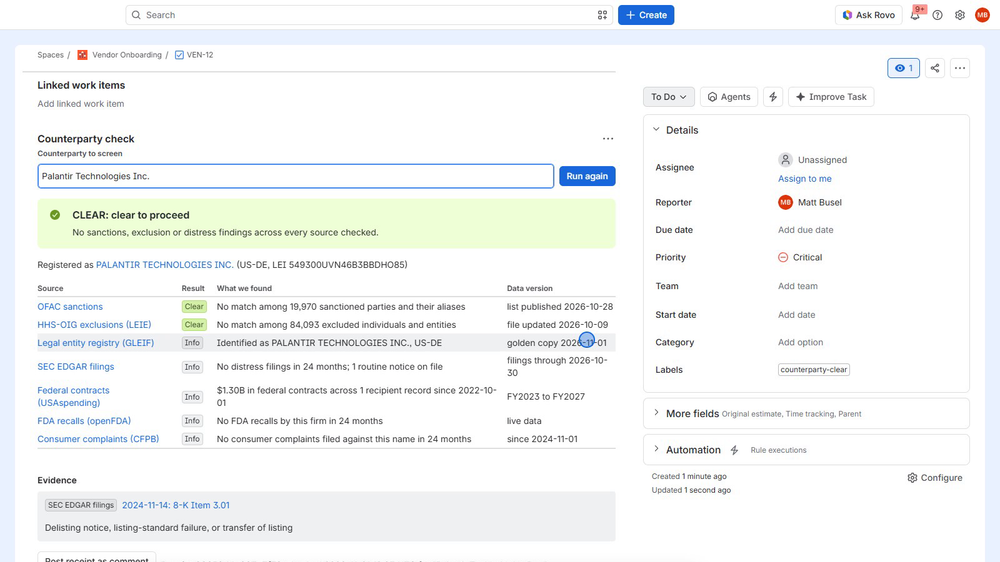

# Counterparty for Jira

**Third-party due diligence with receipts, inside Jira.** Type a vendor, supplier or partner name on a Jira work item and get a CLEAR, REVIEW or BLOCK verdict from seven official public sources in a few seconds, with an evidence link behind every finding and an auditable receipt saved on the work item.

Built on Atlassian Forge for [Codegeist 2026](https://codegeist2026.devpost.com/) by Tensorust LLC. MIT licensed.

**Demo video (2:45):** https://youtu.be/6othkM27_h4



## The problem

Before a company pays or onboards a new vendor, someone in procurement, finance or compliance has to answer a few questions:

- Is this company, or anyone who owns it, on a U.S. sanctions list? OFAC sanctions are strict liability: paying a listed party is a violation even if you did not know.
- If we bill Medicare or Medicaid, is this supplier excluded by the HHS Office of Inspector General? Paying an excluded party can bring civil monetary penalties for every item or service involved.
- Does the company legally exist, where is it registered, and who is its parent?
- If it is public, has it disclosed a bankruptcy, a restatement or a late filing?
- Has it done this work for the federal government before, recalled products, or drawn consumer complaints?

Today that means opening a different government website for each question, screenshotting results, and pasting them into the onboarding ticket. Nobody records which version of each list was checked, and nobody rechecks the vendor when the lists change next month.

## What Counterparty does

- **One click, seven sources.** The Counterparty check panel on any Jira work item screens a name against OFAC (SDN and consolidated lists, every alias), the HHS-OIG exclusion list (LEIE), the GLEIF legal entity registry (including direct and ultimate parents), SEC EDGAR filings, USAspending.gov federal contracts, openFDA recalls and the CFPB consumer complaint database.
- **Joins, not just lookups.** The registered legal name and every parent company found in GLEIF are screened against the sanctions lists too. A vendor whose parent sits in Russia, or whose registered name is on the SDN list under a different spelling, gets flagged even when the name the requester typed looks clean.
- **A verdict a person can act on.** BLOCK for a strong sanctions or exclusion match, REVIEW for possible matches, ownership in a high-risk jurisdiction, distress filings or Class I recalls, CLEAR when nothing turns up. If a required source (OFAC or HHS-OIG) cannot be reached, the verdict is REVIEW, never CLEAR.
- **Receipts.** Every check records the data version of each source (for example "OFAC list published 2026-10-27"), the evidence links, and a receipt id (a hash of what was found). Post it as a comment with one click.
- **Automatic intake.** A new work item titled `Vendor: Acme Medical Supply Inc.` (or labeled `vendor`) is screened as soon as it is created, labeled `counterparty-clear`, `counterparty-review` or `counterparty-block`, and gets the receipt comment.
- **JQL.** Results are indexed on the work item, so `counterpartyVerdict = BLOCK`, `counterpartyChecked < -30d` or `counterpartyFlaggedSource = ofac` work in filters, boards and automation.
- **Continuous monitoring.** A daily scheduled job rescreens every open counterparty against the newest lists and comments on the work item when a verdict changes.
- **Counterparty register.** A Jira page lists every screened counterparty with verdict counts, the reason, and a "Rescreen all now" button.
- **Rovo agent and MCP tools.** The Counterparty Analyst agent screens names in chat, explains the evidence in plain language and posts receipts. The same four tools are exposed through a `rovo:mcp` module, so Rovo Studio agents and external MCP clients (Claude, Cursor and others) can call them.

## Sources

| Source | What it answers | How it is used |
| --- | --- | --- |
| [OFAC sanctions lists](https://sanctionssearch.ofac.treas.gov/) (SDN + consolidated, with aliases) | Is the party sanctioned by the U.S. Treasury? | Fuzzy name match on primary names and every a.k.a.; 92%+ match is BLOCK, 80 to 92% is REVIEW |
| [HHS-OIG LEIE](https://oig.hhs.gov/exclusions/) | Is it excluded from Medicare and Medicaid? | Entities and individuals, with exclusion authority explained in plain words and waivers respected |
| [GLEIF](https://search.gleif.org/) | Who is it legally, where, is it active, who owns it? | Identity, registration status, direct and ultimate parent; parents and legal name are screened against OFAC |
| [SEC EDGAR](https://www.sec.gov/edgar/search/) | Is a public filer in distress? | 8-K items 1.03, 2.04, 3.01, 4.01, 4.02, NT 10-K / NT 10-Q late filings and Form 15 deregistrations in the last 24 months |
| [USAspending.gov](https://www.usaspending.gov/) | Has the U.S. government paid it, how much, for what? | Contract obligations for the last five fiscal years, top awards, UEI |
| [openFDA](https://open.fda.gov/) | Has it recalled devices, drugs or food? | Recalls in the last 24 months; Class I (most serious) is REVIEW |
| [CFPB complaints](https://www.consumerfinance.gov/data-research/consumer-complaints/) | How do consumers rate a financial-services vendor? | Complaint volume, top products, share answered late |

Every source is free, official and needs no API key. The app only reaches the hosts declared in `manifest.yml`.

## How it is built

| Forge feature | Used for |
| --- | --- |
| `jira:issuePanel` (UI Kit) | The Counterparty check panel |
| `jira:globalPage` (UI Kit) | The Counterparty register with counts and a donut chart |
| `jira:entityProperty` | JQL aliases `counterpartyVerdict`, `counterpartyVendor`, `counterpartyLegalName`, `counterpartyChecked`, `counterpartyFlaggedSource` |
| `consumer` + `@forge/events` Queue | Screens run in the background so the UI never hits the 25 second limit |
| `trigger` (`avi:jira:created:issue`) | Automatic screening of new intake work items |
| `scheduledTrigger` (daily) | Rescreening open counterparties |
| `@forge/kvs` | Full reports, job status and check history per work item |
| `rovo:agent` + 4 `action` modules | Counterparty Analyst agent |
| `rovo:mcp` | The same 4 tools for Rovo Studio and external MCP clients |
| `external.fetch.backend` egress | Exactly the 10 government and registry hosts used |

The screening engine in `src/core` is plain JavaScript with no Forge dependencies, so it runs the same in Node for tests and from the command line:

```
npm install
npm test                       # unit + offline pipeline tests
npm run test:live              # live checks against today's public data (LIVE=1)
node scripts/screen.mjs "Sberbank Capital"
```

## Install and test (for judges)

1. Open the installation link from the Devpost submission and install **Counterparty** on your Jira site. No configuration and no API keys are needed.
2. Create a work item in any project titled `Vendor: Sberbank Capital`. Within a few seconds the app labels it `counterparty-block` and posts a receipt comment (OFAC SDN match, Russia-related programs).
3. Open any work item, choose **Apps > Counterparty check** under the title, type a name and press **Run check**. Good test names:
   - `1 Best Care, Inc.`: BLOCK, on the HHS-OIG exclusion list.
   - `Rosneft`: BLOCK, OFAC alias match, and GLEIF shows the registered entity in Russia.
   - `Palantir Technologies Inc.`: CLEAR, identity confirmed in GLEIF and SEC, federal contract history from USAspending.
   - `Abbott Laboratories`: CLEAR, identity confirmed in GLEIF and SEC, with federal contract and FDA recall history shown for context.
4. Press **Post receipt as comment** to save the evidence on the work item.
5. Open **Apps > Counterparty register** in the Jira sidebar to see every screened counterparty. Try JQL `counterpartyVerdict = BLOCK`.
6. Rovo: open Rovo Chat, pick **Counterparty Analyst** under agents, and ask "Is Sberbank Capital safe to pay?" or, on a work item, "Screen the vendor on this work item and post the receipt".
7. MCP: an admin can enable the tools under Atlassian Administration > Apps > Sites > your site > Connected apps, then add `https://mcp.atlassian.com/forge/d86d1b88-c157-40ff-926b-288eeec0bb41` as a remote MCP server in any MCP client. See [docs/skill.md](docs/skill.md).

## Recording the demo

The demo video is recorded for real by `scripts/demo/record.mjs`: it drives Jira on an Atlassian demo site in headless Chrome (session cookies copied from a signed-in Chrome over DevTools), narrates each scene with Piper (local text to speech), cuts out page loads, marks sped-up waits with a speed badge, and assembles the MP4 with ffmpeg.

## Honest limits

- Name screening only. A possible match should be confirmed with address, country, registration number or date of birth before anyone acts on it; the agent tells the reviewer exactly that.
- SAM.gov exclusions need a per-user API key, so they are not included yet.
- Counterparty reports what official public records show. It is not legal advice.

## License

MIT. Copyright 2026 Tensorust LLC.
